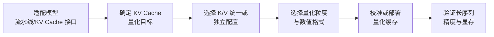

# KVCache Quant 参数配置流程指南

## 1. 适用范围

KVCache Quant 缓存量化算法。KVCache Quant 作为缓存量化处理器，对写入 KV Cache 的 Key/Value 状态进行 INT8/FP8/FP4/MXFP/HiF4 等低比特量化，用于降低缓存显存占用、提升长序列推理效率。

## 2. 输入和交付件

| 类型 | 名称 | 来源或保存位置 | 格式或约束 | 验收方式 |
| --- | --- | --- | --- | --- |
| 输入 | 目标模型与量化目标 | 待量化模型及部署/评测方案 | 明确目标数值格式或位宽、作用模块、精度/性能目标以及部署约束 | 能说明为什么选择本算法以及它在整体量化方案中的位置 |
| 输入 | 模型适配器 | 用户适配代码，通过 `--model_type` 调用 | 实现 `IModel` 及 `DynamicCacheAdapterInterface`（可选）接口 | 能被调度器（Runner）与处理器（Processor）正常驱动 |
| 输入 | 配置约束与实践基线 | 本算法配置说明、目标模型已有 `lab_practice` 配方（如有） | 字段名、支持组合、作用范围和模型适配与当前版本一致 | 推荐起点能够追溯到当前配置定义或已验证实践 |
| 输入 | 校准数据（算法需要时） | 任务 `dataset`、校准集或模型实践配方 | 数据应能代表真实输入分布；多阶段算法尽量保持各阶段数据分布一致 | 能被当前量化流程正常读取，并覆盖主要输入形态 |
| 交付件 | KVCache Quant 参数配置方案 | 用户量化 YAML 或任务配置 | 参数取值合法、作用范围明确；关键参数说明选择依据 | 可作为后续量化流程的算法配置输入，并可复现本指南中的基线选择 |

## 3. 流程总览



## 4. 操作步骤

### 步骤 1：适配模型流水线与 KV Cache 接口

**目标**：量化工具不能直接操作任意结构的模型，需要适配器将模型操作转换为标准方法。对于 KVCache Quant，模型适配器需支持模型加载、逐层遍历和前向执行。如果默认的 attention 类名匹配无法准确识别 attention 模块，还需实现 `DynamicCacheAdapterInterface` 专用的 `inject_kvcache_placeholders` 方法，在 Attention 指定位置注入量化占位模块。

**操作**：模型适配代码需实现以下接口：

1. **`IModel`**（`ModelSlimPipelineInterfaceV1`）：基础流水线接口，负责模型加载（`init_model`）、数据预处理（`handle_dataset`）、逐层遍历（`generate_model_visit`）、逐层前向（`generate_model_forward`）等。
2. **`DynamicCacheAdapterInterface`**（可选）：KV Cache 专用接口。其核心方法 `inject_kvcache_placeholders` 的定义如下：

| 项目 | 内容 |
| --- | --- |
| 方法签名 | `inject_kvcache_placeholders(self, root_name: str, root_module: nn.Module, should_inject: Callable[[str], bool], placeholder_factory: Callable[[], nn.Module]) -> Dict[str, nn.Module]` |
| `root_name` | 当前根模块的完整名称前缀，通常为 `"model"` 或 `""`。在构造返回的 full_name 时，应拼接为 `"{root_name}.{子路径}"`。 |
| `root_module` | 需要扫描安装 placeholder 的根模块。 |
| `should_inject` | 回调函数，接收完整模块路径（已包含 include/exclude 过滤），返回 `True` 表示该模块需要注入量化占位模块。 |
| `placeholder_factory` | 工厂函数，每次调用返回一个新的占位模块实例（默认 forward 为恒等映射）。 |
| 返回值 | `Dict[str, nn.Module]` — key 为 attention 模块的完整路径（如 `model.layers.3.self_attn`），value 为对应的 attention 模块对象。 |

方法需要在 `should_inject` 返回 `True` 的 attention 模块下，通过 `add_module` 安装 `key_states_quantizer` 和 `value_states_quantizer` 两个占位模块（名称固定），并将 `{full_name: attention_module}` 加入返回字典。Processor 后续会通过 `named_modules` 找到占位模块并替换为实际的量化 IR。

参考实现：

```python
from typing import Callable, Dict
from torch import nn

def inject_kvcache_placeholders(
    self,
    root_name: str,
    root_module: nn.Module,
    should_inject: Callable[[str], bool],
    placeholder_factory: Callable[[], nn.Module],
) -> Dict[str, nn.Module]:
    attention_layers = {}
    for name, module in root_module.named_modules():
        full_name = f"{root_name}.{name}" if root_name else name
        if not should_inject(full_name):
            continue
        module.add_module("key_states_quantizer", placeholder_factory())
        module.add_module("value_states_quantizer", placeholder_factory())
        attention_layers[full_name] = module
    return attention_layers
```

默认未实现时，Processor 回退到类名匹配（按模块类名是否包含 `attention` 或 `attn` 识别 attention 层）。需要实现该接口的场景包括：attention 模块类名不含 `attention`/`attn`、模型存在多层嵌套或自定义封装、需要精确控制 placeholder 安装位置等。

对于基于 HuggingFace Transformers 实现的标准开源 LLM，建议通过组合继承构建适配器：

```python
from msmodelslim.model.interface_hub import (
    IModel,
    ModelInfoInterface,
    ModelSlimPipelineInterfaceV1 as PipelineInterface,
    DynamicCacheAdapterInterface,
)

class MyModelAdapter(TransformersModel, ModelInfoInterface, PipelineInterface, DynamicCacheAdapterInterface):
    pass
```

如需开发新模型适配代码，请参考《[LLM 模型接入量化流程指南](../../ptq/llm/integration_guide_large_language_model_quantization.md)》。请注意：模型适配必须先完成，才能执行后续量化流程。

**输出**：已在框架中注册可用的模型适配器（通过 `--model_type` 调用）。

### 步骤 2：建立推荐配置

**操作**：

下面配置用于建立**第一版可比较基线**。如果目标模型已有 `lab_practice` 配方，优先使用已验证配方。

```yaml
apiversion: modelslim_v1
spec:
  process:
    - type: "dynamic_cache"
      # 不设置 qconfig：使用默认 INT8 per-channel 对称 MinMax。
      include: ["*self_attn*"]
      exclude: []
  save:
    - type: ascendv1_saver
```

**输出**：一份可复现的推荐配置，后续所有参数调整均以此为比较对象。

### 步骤 3：选择并调整参数

**操作**：

ModelSlim 实现入口：
[查看对应实现目录](../../../../../msmodelslim/core/quantization_algorithm/quant/kvcache)

| 配置项 | 含义（原理） | 推荐配置 | 选择与调整建议 |
| --- | --- | --- | --- |
| `type` | 处理器标识，固定为 `dynamic_cache`。 | 固定。 | 不作为调参项。 |
| `qconfig` | K/V 共用的一套量化配置；与 `details` 互斥。两者都省略时，当前处理器构造默认 INT8、`per_channel`、对称、MinMax 配置。 | 第一次验证可省略，使用默认 INT8 per-channel。 | 统一配置能满足精度时不要使用 `details` 增加复杂度。 |
| `qconfig.dtype` | KV Cache 数值格式。当前支持 `int8`、`fp8_e4m3`、`fp4_e2m1`、`mxfp4`、`mxfp8`、`hif4`。 | 优先 `int8` 建立基线；目标后端支持低位宽格式时按部署需求选择。 | dtype 是部署目标，不是简单“精度旋钮”。更低位宽/其他格式只有在对应量化器和部署链都支持时再尝试。KV Cache 误差会随序列长度持续进入注意力计算，因此不要仅按显存收益选择位宽。 |
| `qconfig.scope` | 尺度粒度，决定哪些元素共用量化区间。当前支持静态粒度 `per_channel`、`per_head` 和动态粒度 `per_token`、`per_tile`、`per_block`。 | 仓库基线为 `per_channel`；动态量化场景可使用 `per_token`/`per_block`。 | 静态粒度需要校准统计；动态粒度由部署侧运行时计算 scale，导出侧不保存。优先按模型实践和部署格式选，不要只依据粒度“越细越好”。 |
| `qconfig.symmetric` / `method` | 决定是否有 zero-point 以及如何估计尺度。默认与主要实践均使用对称 + MinMax。 | 优先 `symmetric: true`、`method: minmax`。 | 只有注册组合和部署端明确支持其他设置时才偏离。 |
| `details` | 允许 `k_qconfig` / `v_qconfig` 分别配置，适合 K 和 V 敏感性不同或目标格式不同的场景；某一路配置为 `null` 时该分支不量化。 | 入门不设置。只有统一 `qconfig` 无法兼顾 K/V 精度时再拆分。 | 先用量化评测定位是 K 还是 V 更敏感，再只调整敏感分支。不要一开始就给 K/V 不同配置，否则很难归因。 |
| `include` | 作用范围白名单。 | 无模型专用配方时从 `["*self_attn*"]` 开始。 | 先保证范围覆盖预期模块，再看精度。收窄范围时优先按结构族调整。 |
| `exclude` | 作用范围黑名单，优先级高于 `include`。 | 默认保持空列表。 | 局部精度问题优先通过 `exclude` 做小范围回退。 |

#### 参数组合与选择顺序

KVCache Quant 的首要决策是 `qconfig` 统一配置还是 `details` 分路配置。先统一，再定位敏感分支；只有证据表明 K/V 需求不同才拆分。每轮只改一个变量，并保持同一校准集和评测集；若调整后没有稳定收益，回到上一个基线。

**输出**：一份完成单变量调整的算法参数方案，关键字段均有明确的选择依据和调整方向。

### 步骤 4：编写量化配置并执行命令

**目标**：整合上述步骤生成完整的 YAML 量化配置文件，并通过 CLI 启动量化流程。

#### 完整示例：KV Cache Quant + W8A8 动态量化（推荐起点）

##### 配置文件：`kv_cache_w8a8.yaml`

```yaml
apiversion: modelslim_v1
spec:
  runner: auto
  process:
    - type: dynamic_cache              # KV Cache 量化
      qconfig:
        dtype: int8
        scope: per_channel
        symmetric: true
        method: minmax
      include: ["*self_attn*"]
      exclude: []
    - type: linear_quant               # 衔接 W8A8 动态量化
      qconfig:
        act:
          dtype: int8
          scope: per_token
          symmetric: true
          method: minmax
        weight:
          dtype: int8
          scope: per_channel
          symmetric: true
          method: minmax
      include: ["*"]
  save:
    - type: ascendv1_saver             # 昇腾推理标准保存格式
  dataset: mix_calib.jsonl             # 内置混合校准集
```

##### 执行命令（单卡量化）

```bash
msmodelslim quant \
  --model_path <浮点模型目录> \
  --save_path <量化权重输出目录> \
  --model_type <模型适配器名称> \
  --config ./kv_cache_w8a8.yaml \
  --device npu \
  --device_id 0
```

**输出**：在指定的 `--save_path` 目录下生成完整的量化权重文件与描述文件。

## 5. 术语

| 术语 | 简述 | 链接 |
| --- | --- | --- |
| KVCache Quant 缓存量化算法 | 说明该算法的定义、核心原理、关键性质、适用场景与限制。 | [《KVCache Quant 缓存量化算法 量化术语百科词条》](./term_kvcache_quant.md) |

## 6. 相关文档

| 接口或文档 | 简述 | 链接 |
| --- | --- | --- |
| `IModel` / `DynamicCacheAdapterInterface` | 模型流水线与 KV Cache 算法适配接口。 | [接口汇总模块](../../../../../msmodelslim/model/interface_hub.py) |
| dynamic_cache 配置说明 | 字段类型、默认值、合法取值与完整配置约束。 | [《dynamic_cache 配置说明》](../../../api_reference/config/processor/dynamic_cache.md) |
| modelslim_v1 配置说明 | 需要继续探索 runner、prior、save、dataset 等任务级高级配置时查阅。 | [《modelslim_v1 配置说明》](../../../api_reference/config/quant/modelslim_v1.md) |
| 权重量化使用指南 | 用户指南：量化命令参数与完整使用说明。 | [《权重量化使用指南》](https://gitcode.com/Ascend/msmodelslim/blob/master/docs/zh/user_guide/usage_weight_quantization.md) |
